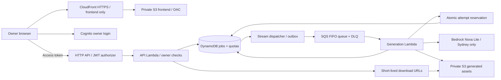

> Historical design proposal. The implemented release and verified limitations are documented in [cloud backend](cloud-backend.md) and [live deployment status](../infra/deployment-status.md). In particular, the input cap is serialized UTF-8 bytes, not exact Nova input tokens.

# TechCanvas AI — Sydney deployment proposal

Status: **reviewed design only; nothing provisioned or deployed**. Checked 25 October 2026. AWS profile: `aws-toolkit`. Project Region: `ap-southeast-2`. The project is currently on an active Free plan. No upgrade, subscription, model invocation, bucket, budget or deployment was enabled during this review.

## Current-experience compatibility

This revision removes the unsupported CloudFront/WAF combination. CloudFront serves only the static frontend through private S3/OAC. The browser calls the Sydney HTTP API directly using a Cognito access token. No WAF, cross-Region resources, flat-rate plan, Paid-plan upgrade or advanced-feature activation is part of this design. It is an owner-only MVP proposal, not a claim that the current app has these protections or that deployment has been validated.

## Recommendation

Use a small, authenticated serverless application with **capped Bedrock text inference**, keeping the existing SVG diagram and browser PNG rendering. The hosted app will generate content while the Mac is off. Preserve the working local Ollama/SQLite workflow as a separate development mode.

This is a refactor of the cloud backend, not a claim that the current localhost server can be uploaded unchanged. It has more implementation work than Lightsail but avoids an idle server and uses scoped execution roles for AWS access.

Regional storage, authentication, functions, queue and inference stay in Sydney. CloudFront is global and has no WAF association. There are no additional Regional application resources in us-east-1, no Lambda@Edge and no cross-Region inference/replication.

## What the code review found

| Current implementation | Deployment consequence | Planned change |
| --- | --- | --- |
| `server.mjs`: loopback listener and localhost Host/Origin allowlist | A public hostname is rejected; there is no user login | Add authenticated cloud handlers, an explicit cloud API base URL, and exact cloud-origin configuration; preserve local checks |
| `ollama-provider.mjs`: fixed localhost model URL, cloud names rejected | Hosted code cannot call the Mac when it is off | Add a separate, default-off Bedrock adapter; keep the local-model guard |
| `core.mjs`: SQLite + local asset files | Lambda temporary disk cannot be the durable store | Implement DynamoDB job/idempotency/quota records and private S3 assets |
| `server.mjs`: in-process Promise queue | Work may be lost when a request process stops | Use durable jobs, outbox dispatch and SQS workers; explicitly handle duplicates |
| `core.mjs`: S3 adapter shells out to AWS CLI | Not an appropriate production credential/runtime dependency | Use scoped SDK clients and function execution roles; no copied local login credentials |
| `.env.example`: existing S3 example Region is `ap-south-1` | A future deployment must not inherit that example | Cloud configuration must explicitly use Sydney and validate it at startup |
| Existing SVG renderers and browser Canvas exporter | These do not need paid image generation | Reuse them; validate exported images in the cloud build |

Local tests currently pass for local behavior; they do not prove cloud deployment readiness.

## Cloud component decisions

- **Frontend:** existing HTML/CSS/JS in a private S3 bucket with CloudFront OAC and the default CloudFront HTTPS domain; no WAF association. This serves public application assets, not public job data. CloudFront response headers must include a suitable CSP, HSTS and content-type/frame protection. Configure API, Cognito and signed-download hosts narrowly in CSP. Domain purchase and Route 53 hosted zones are excluded.
- **Authentication:** one owner, Cognito Essentials, self-signup disabled. JWT subject must match each job's owner on list/read/retry/download endpoints. No SMS authentication in this estimate. Access tokens stay in memory; use the authorization-code/PKCE flow and narrowly allowed callbacks/origins.
- **API:** short Event Function handlers behind HTTP API. HTTP API is cheaper than REST API and has native JWT authorization. We do not need REST API's usage plans, API keys or caching. The existing Node HTTP entry point is intentionally split into handlers; this is not deployment of an unchanged Node server. The browser calls the regional API endpoint directly; it is not behind CloudFront or WAF. Require a scoped Cognito access token on every data/mutation route and verify its owner subject in the handler. Configure exact frontend-origin CORS and handle preflight without weakening data-route authorization. CORS is a browser control, not authentication or a protection against direct non-browser calls. Never cache authenticated API responses.
- **Durability:** DynamoDB on-demand, one Region, owner-scoped job access and idempotency records. This is an explicit SQLite refactor, not an automatic managed-database migration. No relational joins are needed by the current job operations.
- **Queue:** transactional job/outbox write, DynamoDB stream dispatcher, SQS FIFO with one message group for this owner-only MVP, batch size 1, dead-letter queue. Queue redelivery must not duplicate a completed generation. Worker leases and conditional updates protect state. A dispatcher retry must not lose a queued job.
- **Inference:** candidate `amazon.nova-lite-v1:0`, direct Sydney on-demand invocation. The regional catalog lists it ACTIVE with ON_DEMAND support. Its price was verified, **not its technical-writing quality or this project's ability to invoke it**. No cross-Region profile or automatic model fallback. It must pass a small, separately approved paid evaluation before release.
- **Storage:** private S3 with public access blocked; owner-authorized, short-lived export URLs. S3 download CORS permits only the chosen frontend origin. Keep model weights out of cloud artifacts. Set an explicit asset retention policy and a storage allowance before release.
- **Security:** scoped roles per handler/dispatcher/worker, regional resource ARNs, no developer credentials on the server, input validation, JWT owner checks, low API route/stage throttles, short log retention and redacted logs. Do not add WAF, paid Shield Advanced, Bot Control or third-party rule groups. Throttles are best-effort targets, not hard request or billing ceilings.
- **Operations:** proposed 7-day log retention, failure/DLQ visibility and small backups. Verify exact backup/alarm pricing against the reserve before approval. Alerts warn; they do not enforce a total AWS billing cap.

## Proposed usage and cost controls

These are implementation requirements, **not controls already installed**:

1. Maximum **300 billable model attempts per UTC calendar month**, including retries and paid evaluation calls; maximum **20 per UTC day**. Successful packs can be fewer than attempts.
2. Atomically reserve a counter before every actual inference request. Count ambiguous failures conservatively; do not refund a request that may have reached the model. Fail closed if quota reservation fails.
3. Maximum **6,000 total input tokens** including the system prompt and reference notes, and **1,600 output tokens**. Count tokens or conservatively bound the full request before reserving its cost; reject requests that cannot be bounded safely.
4. One active generation using one FIFO message group and batch size 1. Configure event-source maximum concurrency 2 and function reserved concurrency at least 2; FIFO group ordering, not an invalid maximum-concurrency value of 1, provides serialization. No provisioned pollers. At most two explicit paid attempts per logical job. Disable hidden SDK/model retries and fallback models unless a separate reservation is made.
5. Explicit worker timeout and queue visibility settings, duplicate-safe state transitions, a bounded retry policy and a DLQ. A failure after a model call must not silently trigger unlimited calls.
6. Owner-only generation and disabled public signup. Start with low route/stage throttles and exponential-backoff polling. These are not substitutes for WAF. Use backend owner authorization and atomic inference reservations to prevent anonymous model use. Reassess the design before adding public signup or a multi-user launch.
7. Configure cost alerts below the target after approval, and review AWS Settings > Billing before any paid-plan transition. Keep existing S3-upload and future Bedrock approval flags off until authorized.

An application inference quota limits model calls, **not all AWS charges**. Hosting, storage, authentication, API requests, data transfer and abusive traffic can still accrue charges. JWT rejection prevents unauthorized backend/model access but does not guarantee that rejected API requests are unbilled. The current Free plan also has credit/expiry constraints; ongoing availability after that requires another decision, not an automatic upgrade.

SQS empty receives also cost money. The estimate budgets one million FIFO queue operations per month rather than assuming only sends/deletes for successful jobs. Measure this during the approved pilot.

## Remaining exposure and release gates

Without WAF, this design does not provide managed web-application firewall inspection, WAF bot rules or a WAF per-IP rate rule. Keep signup disabled and the owner-only boundary explicit. Alerts and the model quota do not stop every hosting/request charge. Before any release, validate token type/scopes/issuer/audience, per-owner authorization, preflight behavior, signed-export isolation, quota race conditions, polling costs and regional model access. A public or multi-user release needs another security and cost review; do not silently activate advanced features to add a firewall.

## Alternatives considered

| Option | Assessment |
| --- | --- |
| Serverless + capped Bedrock | Recommended for generation while the Mac is off. More backend changes, small variable costs, execution roles, no idle VM. |
| Lightsail 1 GB IPv4 + SQLite | Sydney catalog confirms $7/month, 40 GB disk and 1024 GB bundled transfer. Good for minimal-change hosting, but the existing Ollama provider is unavailable on that VM and a 1 GB VM cannot host the selected local model. Secure AWS-inference credential integration must be designed separately; no promise that a VM alone solves cloud AI. |
| Local generation + uploaded library | Cheapest and preserves Qwen quality, but does not meet the user's requirement to generate with the Mac off. |
| RDS/always-on model server/load balancer | Unnecessary for this owner-only MVP; do not include fixed infrastructure without a measured need and revised budget. |

CloudFront's $0 flat-rate plan is **not available to a Free-plan project** according to the current eligibility documentation. This proposal uses pay-as-you-go rates and does not require a plan upgrade or assume bundled WAF.

## Implementation sequence

1. **Local cloud preparation:** define job/storage/provider interfaces, add a gated Bedrock adapter with fake responses, implement identity/owner checks and transactional quota logic. Keep the current local mode working.
2. **Local infrastructure preparation:** create reviewable IaC for the listed components, scoped IAM policies, region guards, retention and counters. Synthesize/package locally; do not bootstrap or deploy.
3. **Validation:** test unauthorized access and cross-owner requests, idempotency conflicts, concurrent quota exhaustion, SQS duplicates, failure-after-inference handling, retries/DLQ, output validation and PNG downloads. Confirm a supported Lambda Node runtime, architecture, quotas and model access.
4. **Approval packet:** present the final resource list, synthesized changes, calculator output, alert/backup choices, a bounded model-evaluation allowance and cleanup procedure. Only then request deployment/model-call approval.
5. **After explicit approval:** deploy only the reviewed resources, run the bounded model-quality evaluation, verify actual costs and enforce the app quotas. Upgrade nothing automatically. Ask whether to keep or remove deployed resources when work is complete.

No deployment command or infrastructure template is provided as a ready-to-run shortcut in this planning change.

## Evidence

- Read-only AWS CLI: `freetier get-account-plan-state`, `lightsail get-bundles`, `bedrock list-foundation-models`.
- Public Price List `GetProducts` queries for Sydney; selected public SKUs and unit rates are in `aws-pricing-sydney.json`. No project identifier or credentials are included.
- [Supported services for the new AWS experience](https://docs.aws.amazon.com/accounts/latest/reference/supported-services-sign-up-new.html).
- [Bedrock pricing](https://aws.amazon.com/bedrock/pricing/) and [supported model catalog](https://docs.aws.amazon.com/bedrock/latest/userguide/models-supported.html).
- [Project Region and CloudFront/WAF restrictions](https://docs.aws.amazon.com/accounts/latest/reference/project-regions.html), [CloudFront plan eligibility](https://docs.aws.amazon.com/AmazonCloudFront/latest/DeveloperGuide/flat-rate-pricing-plan.html) and [CloudFront pricing](https://aws.amazon.com/cloudfront/pricing/).
- [HTTP API JWT authorization](https://docs.aws.amazon.com/apigateway/latest/developerguide/http-api-jwt-authorizer.html), [CORS](https://docs.aws.amazon.com/apigateway/latest/developerguide/http-api-cors.html) and [best-effort throttling](https://docs.aws.amazon.com/apigateway/latest/developerguide/http-api-throttling.html).
- [Cost estimate and assumptions](aws-costs.md), regenerated with `python3 scripts/estimate-aws-costs.py`.
