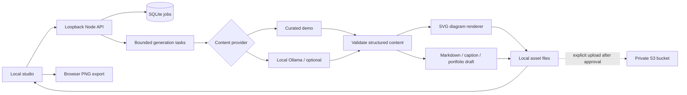
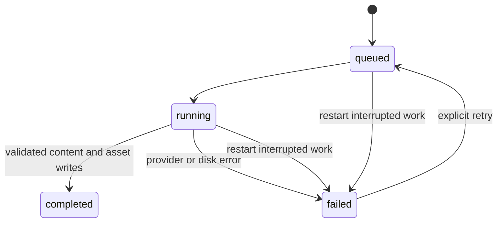

# TechCanvas AI — MVP design

## Goal

Turn a technical concept into visual learning notes and reusable writing, with explicit review before sharing. Recovered requirements came from the “Backend Experience Preferences” chat: concept images in S3, a summary image, sentence, paragraph and blog post, Instagram sharing and portfolio publishing, approximately ₹1,000/month AWS budget.

## Repository decision

One independent `techcanvas-ai` Git repository keeps the studio, API, worker, tests and documentation together. Existing Next.js portfolio and NestJS portfolio API remain independent. Splitting the new MVP across repositories would add release coordination without a scaling benefit. Source is hosted at https://github.com/Lokesh-Burma/Tech-Canvas-AI.

## Current flow

## Job lifecycle

SQLite stores metadata/content and an optional unique request key with request fingerprint. An async task writes assets via temporary files and rename, then marks completion. Readers cannot access partial assets. Restarted tasks fail visibly rather than duplicate AI work. Idempotency applies to request creation, not automatic external publishing. Five jobs can be active at once. One process per database.

## Delivery boundaries

- Working offline path: curated topic → saved content pack → SVG, Markdown, caption and portfolio JSON downloads.
- Local model adapter: schema-constrained JSON from a loopback-only Ollama runtime; local setup and live evaluation commands are included.
- Image generation: diagram composition, not a hosted generative image model.
- S3: AWS CLI adapter with a default-off approval gate; tested without AWS calls. No public URLs or bucket provisioning.
- Instagram and portfolio: manual exports; automatic publishing and authentication are future integrations.
- No paid provider, deployment or AWS resource is enabled.

## Next milestones

1. Evaluate generated drafts and add an editing/review workflow.
2. Review the proposed hosting bill and approve any AWS usage.
3. Add authenticated HTTPS hosting, scoped private S3 access, retention/backups and budget alerts.
4. Add portfolio draft creation with explicit user review. Instagram publishing requires a separately authorized integration.

## Visual memory aid

Each pack includes an additional icon/diagram image with a recall cue. Curated examples use topic-specific flows; custom AI topics use a connected concept map. SVG is persisted with the other assets; Canvas exports PNG in the browser. Older completed packs lazily receive this new asset using their stored content, without another inference request.

## Local model runtime

`scripts/ollama.mjs` controls explicit runtime startup/model download/readiness checks. Cloud features are disabled, model names are restricted to local tags, and model files stay out of Git. The provider validates structured output, handles missing models/timeouts and never falls back silently to demo content. The API serializes generation so a single GPU request runs at a time while up to five jobs remain active/queued.

The selected local model is Qwen3 4B. Three reviewed reference-note entries ground indexing, circuit breakers and consistent hashing; source links accompany those drafts. Other custom topics have no automatic source grounding. Source notes are bundled locally, with no runtime web search. Live evaluations check exports and known regressions; human review remains required.
